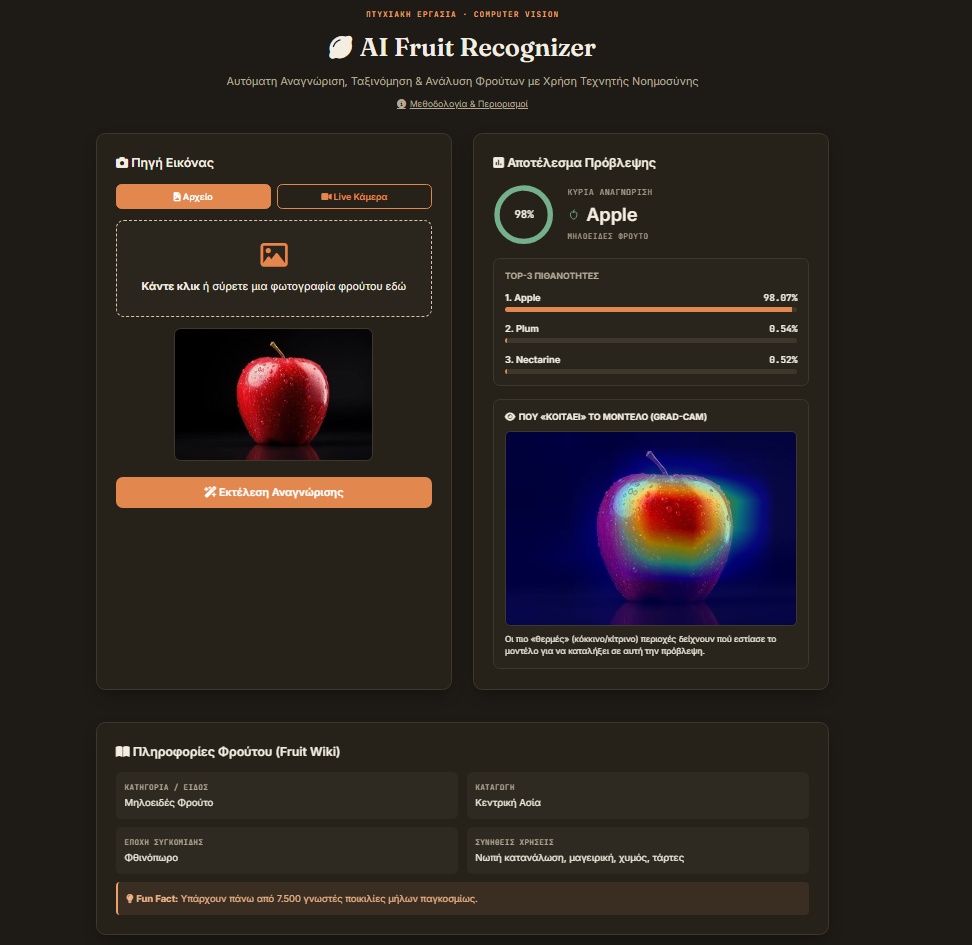

# AI Fruit Recognizer

Web εφαρμογή που αναγνωρίζει φρούτα, λαχανικά και ξηρούς καρπούς από φωτογραφία, με χρήση βαθιάς μάθησης (MobileNetV2, transfer learning) και οπτική εξήγηση της πρόβλεψης μέσω Grad-CAM.

Αναπτύχθηκε ως πτυχιακή εργασία στο Τμήμα Ψηφιακών Συστημάτων του Πανεπιστημίου Θεσσαλίας (ακαδημαϊκό έτος 2025–2026) από τον Χρήστο Μηλαροκώστα.

**Ζωντανή εφαρμογή:** https://fruitrecognizer.app



## Τι κάνει

- **Αναγνώριση 45 κλάσεων** από αρχείο εικόνας (και πολλά αρχεία μαζί) ή από την κάμερα της συσκευής.
- **Top-3 πιθανότητες** και προειδοποίηση όταν η βεβαιότητα είναι χαμηλή.
- **Grad-CAM**: θερμικός χάρτης που δείχνει ποια σημεία της εικόνας επηρέασαν την πρόβλεψη.
- **Fruit Wiki**: κατηγορία, καταγωγή, εποχή, χρήσεις και ένα fun fact για το φρούτο που αναγνωρίστηκε.
- **Ιστορικό αναλύσεων** με αναζήτηση, φίλτρα ημερομηνίας, ταξινόμηση, διαγραφή και εξαγωγή σε Excel, CSV ή JSON. Το ιστορικό είναι προσωπικό ανά browser: κάθε επισκέπτης βλέπει και διαχειρίζεται μόνο τις δικές του αναλύσεις.
- **Σκούρο και φωτεινό θέμα**, και διάταξη που προσαρμόζεται σε κινητά.

## Τεχνολογίες

| Επίπεδο | Τεχνολογία |
| --- | --- |
| Μοντέλο | PyTorch, torchvision (MobileNetV2 προεκπαιδευμένο στο ImageNet) |
| Backend | Python 3.10, FastAPI, Uvicorn |
| Βάση δεδομένων | SQLite μέσω SQLAlchemy |
| Frontend | HTML, CSS, JavaScript χωρίς framework |
| Deployment | Docker, Render |

## Εκτέλεση τοπικά

Χρειάζεται Python 3.10. Το εκπαιδευμένο μοντέλο (`fruit_mobilenetv2.pth`) περιλαμβάνεται στο αποθετήριο, οπότε δεν απαιτείται εκπαίδευση για να τρέξει η εφαρμογή.

```bash
git clone https://github.com/chrismilarokostas-glitch/fruit-recognizer.git
cd fruit-recognizer
python -m venv venv
venv\Scripts\activate        # σε Linux/macOS: source venv/bin/activate
pip install -r requirements.txt
uvicorn main:app --reload
```

Η εφαρμογή ανοίγει στο http://localhost:8000 και η τεκμηρίωση του API στο http://localhost:8000/docs.

### Με Docker

```bash
docker build -t fruit-recognizer .
docker run -p 8000:8000 fruit-recognizer
```

### Ρυθμίσεις

| Μεταβλητή περιβάλλοντος | Προεπιλογή | Περιγραφή |
| --- | --- | --- |
| `DB_PATH` | `./fruits_history.db` | Θέση του αρχείου SQLite. Σε hosting με εφήμερο filesystem πρέπει να δείχνει σε μόνιμο δίσκο. |
| `PORT` | `8000` | Θύρα του server μέσα στο container. |

## API

Όλα τα endpoints εκτός από το `/api/health` απαιτούν την κεφαλίδα `X-Client-Id` (τυχαίο αναγνωριστικό 16–64 χαρακτήρων, το παράγει αυτόματα το frontend). Κάθε εγγραφή ιστορικού ανήκει στο αναγνωριστικό που τη δημιούργησε.

| Μέθοδος | Διαδρομή | Περιγραφή |
| --- | --- | --- |
| GET | `/api/health` | Έλεγχος λειτουργίας |
| POST | `/predict` | Ανέβασμα εικόνας (έως 10 MB). Επιστρέφει πρόβλεψη, Top-3, Grad-CAM και πληροφορίες φρούτου |
| GET | `/history` | Το ιστορικό του χρήστη |
| GET | `/history/{id}/gradcam` | Το αποθηκευμένο Grad-CAM μιας εγγραφής |
| DELETE | `/history/{id}` | Διαγραφή μιας εγγραφής |
| POST | `/history/bulk-delete` | Διαγραφή πολλών εγγραφών |
| GET | `/export-excel`, `/export-csv`, `/export-json` | Εξαγωγή του ιστορικού |

## Μοντέλο και δεδομένα

- **Αρχιτεκτονική:** MobileNetV2 με νέο classifier (1280 → 128 → 45) και fine-tuning στα τρία τελευταία blocks.
- **Dataset:** υποσύνολο 45 κλάσεων του [Fruits-360](https://github.com/fruits-360), εμπλουτισμένο με φωτογραφίες από το διαδίκτυο. Το dataset δεν περιλαμβάνεται στο αποθετήριο λόγω μεγέθους.
- **Augmentation:** τυχαία περικοπή, περιστροφή, color jitter, προοπτική παραμόρφωση και τυχαία αντικατάσταση του λευκού φόντου, ώστε το μοντέλο να μη βασίζεται στο φόντο του Fruits-360.
- **Αποτελέσματα:** 98,70% ακρίβεια στο test set (8.933 εικόνες). Αναλυτικά ανά κλάση στο `evaluation_report.csv`, οι καμπύλες εκπαίδευσης στο `training_curves.png`.

### Εκπαίδευση και αξιολόγηση

Τα scripts περιμένουν το dataset στον φάκελο `dataset/` δίπλα στον κώδικα, με έναν υποφάκελο ανά κλάση:

```
dataset/
  train/Apple/...  train/Banana/...
  test/Apple/...   test/Banana/...
```

Η εκπαίδευση χρησιμοποιεί GPU μέσω DirectML (π.χ. κάρτες AMD σε Windows) και χρειάζεται δύο επιπλέον πακέτα:

```bash
pip install torch-directml tqdm
python train_mobilenet.py
python evaluate_model.py
```

Το `train_mobilenet.py` συνεχίζει από το υπάρχον checkpoint αν οι κλάσεις ταιριάζουν και αποθηκεύει μοντέλο, log και καμπύλες μετά από κάθε εποχή. Το `evaluate_model.py` παράγει τα `evaluation_report.csv` και `evaluation_errors.csv`.

## Δομή αποθετηρίου

| Αρχείο | Ρόλος |
| --- | --- |
| `main.py` | FastAPI εφαρμογή: πρόβλεψη, Grad-CAM, ιστορικό, εξαγωγές |
| `database.py`, `models.py` | Σύνδεση SQLite και πίνακας `predictions` |
| `fruit_encyclopedia.py` | Πληροφορίες για τις 45 κλάσεις |
| `static/` | Frontend (HTML, CSS, JavaScript) |
| `train_mobilenet.py` | Εκπαίδευση του μοντέλου |
| `evaluate_model.py` | Αξιολόγηση ανά κλάση και ανάλυση συγχύσεων |
| `fruit_mobilenetv2.pth` | Το εκπαιδευμένο μοντέλο |
| `Dockerfile` | Εικόνα για deployment (CPU-only PyTorch) |

## Περιορισμοί

- Το μοντέλο ταξινομεί ολόκληρη την εικόνα σε μία από τις 45 κλάσεις. Δεν εντοπίζει πολλά φρούτα στην ίδια φωτογραφία και δεν έχει κατηγορία «άγνωστο», οπότε μια εικόνα που δεν είναι φρούτο θα πάρει πάντα κάποια ετικέτα, συνήθως με χαμηλή βεβαιότητα.
- Το test set αποτελείται κυρίως από εικόνες στούντιο του Fruits-360, που μοιάζουν πολύ με τις εικόνες εκπαίδευσης. Σε φωτογραφίες πραγματικών συνθηκών (φυσικό φόντο, διαφορετικός φωτισμός) η ακρίβεια είναι χαμηλότερη από το 98,70%.
- Οπτικά παρόμοιες κλάσεις συγχέονται συχνότερα, με κύριο παράδειγμα το ροδάκινο και το νεκταρίνι.
- Το προσωπικό ιστορικό βασίζεται σε αναγνωριστικό αποθηκευμένο στον browser και όχι σε λογαριασμούς χρηστών: αν καθαριστούν τα δεδομένα του browser, το ιστορικό δεν είναι πλέον προσβάσιμο.
